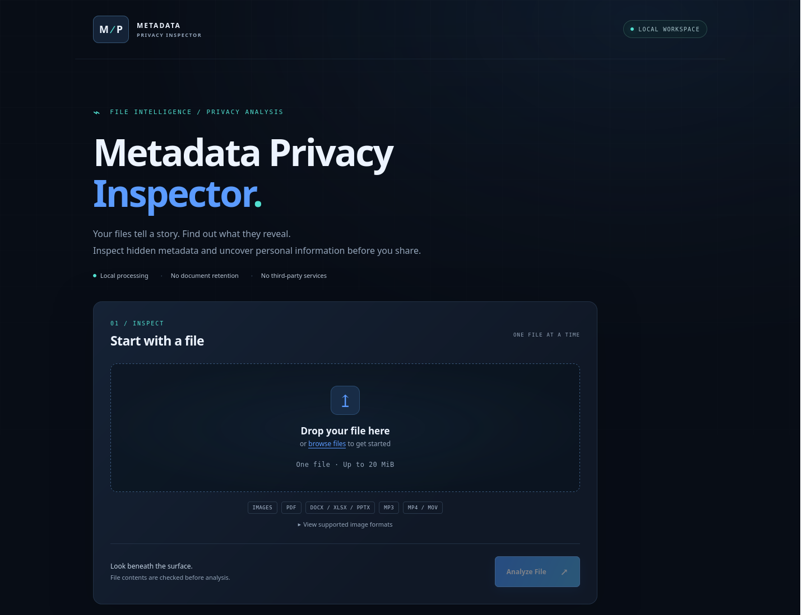

# Metadata Privacy Inspector

## Demo Video

[](https://youtu.be/5oJqF-U3jjw)

**[Watch the demo on YouTube](https://youtu.be/5oJqF-U3jjw)** — a walkthrough of the
local interface: upload a synthetic image with fictional GPS coordinates, inspect
its metadata and privacy alerts, remove supported metadata, and analyse the
cleaned copy to verify that the coordinates are gone.

A Python portfolio project for inspecting metadata in documents, images, audio
and video, identifying signs of personal information, and creating copies with
selective metadata removal. It includes a CLI, a local FastAPI REST API, and an
English web interface built with HTML, CSS and JavaScript without frameworks.

> **Current status: functional for local use, but not ready for public Internet
> exposure.** Publishing the source code and demo does not make the application
> a production web service. There is no authentication, global request quota or
> parser sandbox. Read [SECURITY.md](SECURITY.md) before processing untrusted files.

## Implemented Features

- Select or drag and drop one file; view extracted metadata, a privacy summary
  and alerts, with a highlighted GPS location when detected.
- Inspect PDF, DOCX, XLSX, PPTX, MP3, MP4/MOV and supported raster images.
- Selectively remove metadata from JPG/JPEG, PNG, PDF, DOCX/XLSX/PPTX and MP3,
  with preservation checks and a report of fields that remain.
- Download a cleaned copy without overwriting the original.
- Share extractors between the CLI and API. Tests generate synthetic temporary
  files; personal documents are not required to run them.

## Technologies

| Component | Technologies |
| --- | --- |
| Runtime and API | Python, FastAPI, Starlette, AnyIO, Uvicorn, python-multipart |
| Web interface | HTML, CSS, vanilla JavaScript, browser File and Blob APIs |
| Images | Pillow and EXIF/GPS parsing |
| Documents | pypdf, python-docx, openpyxl, python-pptx, lxml |
| Audio and video | Mutagen, FFprobe from FFmpeg |
| Testing | pytest, HTTPX/TestClient, Node.js built-in test runner; XlsxWriter for test fixtures |

Python dependencies are declared in [requirements.txt](requirements.txt).
FFprobe is an external system dependency.

## Installation

Verified environment: Linux x86_64, Python 3.12.3 and Node.js 18.19.1. Node.js is
only needed for JavaScript tests. FFprobe is required for video analysis; other
formats do not require it. Windows and macOS have not been validated.

Clone the repository and enter the project directory:

```bash
git clone https://github.com/domadordelvent/metadata-privacy-inspector.git
cd metadata-privacy-inspector
python3 --version
python3 -m venv .venv
.venv/bin/python -m pip install -r requirements.txt
.venv/bin/python -m pip check
```

If `venv` is unavailable, install the appropriate package for your distribution.
For videos, install FFmpeg using your system package manager and check that
FFprobe is available and includes security fixes:

```bash
ffprobe -version
```

`requirements.txt` includes the existing test tools. Direct dependency versions
are pinned, but not every transitive dependency or system package: installation
was verified in the environment above, rather than guaranteed to produce an
identical build everywhere. Do not copy a virtual environment from another machine.

## Running the Application

From the project root, with the environment installed:

```bash
.venv/bin/python main.py /path/to/document.pdf
.venv/bin/python web_app.py
```

The API entry point binds exclusively to `127.0.0.1:8000`. Open
`http://127.0.0.1:8000/` in your browser. Keep the application local; do not expose
it through a public interface, reverse proxy or tunnel without addressing its
security gaps. The CLI remains available independently.

## Web Interface

Drag a file onto the page or select it, click **Analyze File**, and review the
summary, all extracted metadata and privacy signals. Embedded GPS coordinates
or location appear in a highlighted section. **Analyze Another File** clears
the report and returns to file selection.

The interface has a responsive dark theme, keyboard navigation, accessible
notifications and reduced-motion support. Application resources are local: no
CDN, remote fonts, maps, telemetry or persistent browser storage. File data is
rendered as text. The original file reference remains in browser memory for
retrying analysis and creating a cleaned copy; it is released when starting
another analysis or leaving the page. The YouTube thumbnail in this README is
external documentation content, not an application resource.

Tests cover the interface routes and eleven JavaScript interaction scenarios
without additional JavaScript dependencies, using Node.js when available.

## Screenshots

Actual initial screen of the local interface, without documents or personal data:



Generate screenshots using synthetic data. Do not publish real reports, personal
document names or coordinates from personal photographs. See the
[screenshot instructions](docs/screenshots/README.md).

## POST /api/inspect

Send exactly one multipart file in a field named `file`:

```bash
curl -F 'file=@/path/to/document.pdf' http://127.0.0.1:8000/api/inspect
```

The response contains three sections:

- `file`: `name`, `extension`, `size_bytes`, `mime_type`.
- `metadata`: the existing extractor's metadata dictionary.
- `findings`: alerts from the existing privacy analyser.

The name is the original basename; temporary paths are not returned. The browser
MIME type is not proof of format: the server validates content. Documents are not
intentionally retained after processing. All endpoint responses, including errors,
include `Cache-Control: no-store`. Abrupt process termination may leave temporary
files, as described below and in the security documentation.

Dates and times are converted to ISO 8601, tuples to lists, EXIF rationals to
numbers, and Decimal values to strings to preserve precision. Bytes are returned
as `{"encoding": "base64", "data": "..."}`. NaN and infinities become `null`.
Unknown types produce a generic error without exposing their representation.
Privacy rules run before serialization.

## Limits and Errors

File limit: 20 MiB. Total HTTP body limit: 20 MiB + 64 KiB for multipart part
headers and boundaries. Actual bytes are counted before multipart parsing,
including without `Content-Length`; incorrect length declarations are rejected.
Only one `file` field is accepted, without additional fields. Multipart must end
with its closing delimiter; epilogues are not accepted.

| HTTP | Meaning |
| --- | --- |
| 400 | Empty, incomplete or malformed upload; incorrect fields or length |
| 413 | File or HTTP body exceeds the size limit |
| 415 | Non-multipart transport or unsupported file format |
| 422 | Incompatible, corrupted or rejected content under validation limits |
| 500 | Unexpected error, missing external dependency or analysis timeout |

Errors return `{"detail": "generic message"}` without stack traces or internal
paths. Copying, validation, extraction and serialization run in a thread pool.
Multipart streams and the temporary HTTP body are closed; the staging context
removes analysis files on normal completion and handled exceptions.

## Tests

```bash
.venv/bin/python -m pytest -p no:cacheprovider
node --test tests/frontend.test.cjs
```

See [SECURITY.md](SECURITY.md) for supported formats, limits and unresolved risks.

## Selective Metadata Removal

After analysis, **Remove Metadata** sends the same original to `POST /api/clean`.
The server creates and verifies an independent copy; **Download Clean File** is
only enabled after successful verification. The report identifies removed,
changed and remaining fields, remaining alerts, and method limitations.

- JPG/JPEG: removes EXIF, XMP, IPTC and comment segments without recompression.
  PNG: removes EXIF, text and timestamps without changing pixels. Colour profiles
  are preserved. Non-neutral orientation, animated PNG and unknown auxiliary or
  provenance structures are rejected.
- DOCX/XLSX/PPTX: only core properties in `docProps/core.xml`. All other members
  are compared byte for byte after decompression. Signed documents, documents
  with macros and unsupported property relationships are rejected.
- PDF: removes document information and document XMP, including orphaned objects.
  Only simple, unencrypted PDFs are supported; signatures, forms, annotations,
  attachments, additional structures and unverifiable compression are rejected.
  Page structures, resources and content are compared. Verification limits
  depth, object count and decompression per stream.
- MP3: removes ID3v1/v2 without re-encoding and verifies that the remaining bytes
  exactly match the original payload. Artwork and other ID3 features are also
  removed. ID3 signatures, APE tags and unsupported structures are rejected.
- MP4/MOV: cleaning is disabled. Other formats remain analysis-only; no additional
  cleaning formats have been introduced.

The copy is validated and analysed again. The XLSX reader supplies default author
and dates for absent properties; the cleaning report excludes these after checking
the actual XML, without changing the existing extractor. Mutagen may estimate a
different duration after ID3v1 removal; the report explains this and verifies
preservation of audio bytes.

The `/api/clean` response contains `name`, base64 `data`, and `report`. The server
removes disk temporaries before sending a successful response and retains the
response bytes in memory. There are no hosted-document tokens or URLs, or retention
until a later download. The browser creates an in-memory Blob with a local URL,
revoked on reset, repeated cleaning or leaving the page. Explicit download saves
the copy to the user's device.

Cleaning does not guarantee removal of all metadata or personal information in
content. It does not remove all revisions, document comments, connections, names
in cells, visible text, embedded resource information or every form of signature
or provenance.

## Architecture

`web_app.py` receives and bounds multipart uploads; `upload_handler.py` validates
and stages temporary files. `inspection.py` coordinates `metadata_extractor.py`
and `privacy_analyzer.py`; `serialization.py` converts values to JSON.
`metadata_cleaner.py` creates and verifies cleaned copies. `static/` contains the
interface and `main.py` provides the CLI entry point.

## Limitations

- Analysis reports fields covered by the extractors; it is not an exhaustive
  audit of embedded data or an antivirus scanner.
- No alerts does not guarantee no personal information. Cleaning does not
  anonymize visible content, revisions, comments or embedded resources.
- MP4/MOV and image formats other than JPG/JPEG/PNG are analysis-only.
- Web limits may reject legitimate files. The CLI does not apply the upload
  validation and limits layer; use it only with trusted files.
- There are no global request limits, hard timeouts for Python parsers or sandbox.
  The FFprobe timeout does not bound all process memory or external accesses.
- Temporaries are removed on normal completion; abrupt termination may leave
  residues, and secure physical erasure is not guaranteed.

## Security Research Roadmap

The project will also serve as a local security research environment for
investigating the gaps detected in the initial review and implementing verifiable
fixes. **These are confirmed missing safeguards and potential risks, not
necessarily demonstrated exploitable vulnerabilities.** Detailed findings and
their evidence are documented in [SECURITY.md](SECURITY.md).

Research will cover:

- Denial of service (DoS) and the absence of global request, concurrency and
  admission limits.
- Slow HTTP uploads and missing upload reception deadlines.
- CPU, memory and processing-time exhaustion in validation and extraction.
- Excessive RAM consumption during image decoding and pixel preservation checks.
- FFmpeg vulnerabilities, pending security updates and system dependency tracking.
- FFprobe isolation and potential unauthorized network or local file access.
- Subprocess output capture without explicit size limits.
- Serialization without explicit size or depth limits.
- Temporary file handling and recovery after crashes or forced termination.
- Deployment security: HTTPS, document privacy, retention and protection against
  abuse.

Tests will run **only in a local, controlled environment with synthetic files**.
Results will record reproduction conditions, versions, resource measurements and
whether a suspected risk is confirmed. Corrections will be evaluated with
repeatable checks and regression tests where appropriate, including verification
that existing behavior and privacy guarantees are preserved.

This roadmap describes future work, not safeguards already implemented. The
application is functional for local use and **is not yet ready for public
Internet exposure**.

## Portfolio Validation

On 2026-10-11, `requirements.txt` was installed in a fresh virtual environment
using Python 3.12.3 on Linux. `pip check` reported no dependency conflicts and
146 Python tests passed. All 11 JavaScript tests passed using Node.js 18.19.1.
Installation used the configured package registry and pip cache; offline
installation and other platforms have not been verified.

Starlette TestClient emits an HTTPX deprecation warning. `httpx2` has not been
introduced and dependencies have not been changed to silence it.

See the [publication review](docs/PUBLISHING.md): historical test samples are
synthetic according to the owner's confirmation. The existing repository history
is preserved; `.gitignore` and index removal do not remove artifacts from earlier
commits.
